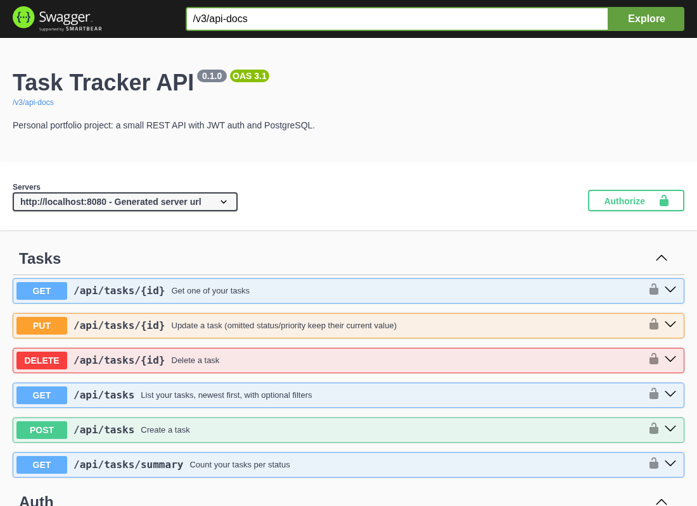
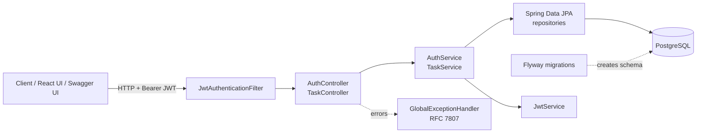

# Task Tracker API

[](https://github.com/prernareddym/task-tracker-api/actions/workflows/ci.yml)


A small REST API for managing personal tasks, built with **Spring Boot**, **PostgreSQL** and **JWT authentication**.

> **Personal portfolio / learning project.** I built it to practice and demonstrate a clean Spring Boot service layout, authentication, database migrations and testing. It is not a production system, has no real users, and is not related to any employer's work.

A React + TypeScript front end for this API lives in [task-dashboard-ui](https://github.com/prernareddym/task-dashboard-ui).



## Features

- Register / log in with email and password (BCrypt-hashed), receive a signed **JWT** (HS256, configurable lifetime)
- Stateless Spring Security filter chain; protected endpoints return `401` without a valid token
- Task CRUD where every query is **scoped to the signed-in user**, so users cannot read or change each other's tasks
- Filtering by status and priority, case-insensitive title search (LIKE wildcards escaped), paging, newest first
- `GET /api/tasks/summary` returns per-status counts for dashboards
- Schema managed by **Flyway** migrations, with `CHECK` constraints and an index on `(owner_id, status)`
- Bean Validation on every request body and consistent **RFC 7807** (`application/problem+json`) errors
- **OpenAPI 3 / Swagger UI** generated with springdoc
- Actuator health endpoint
- Non-root, multi-stage Docker image; `docker-compose` stack with PostgreSQL

## Tech stack

Java 21 · Spring Boot 3.5 (Web, Data JPA, Security, Validation, Actuator) · PostgreSQL 16 · Flyway · jjwt · springdoc-openapi · JUnit 5 · MockMvc · AssertJ · Docker · GitHub Actions

## Architecture



Package layout (`src/main/java/com/prernareddym/tasktracker`):

| Package | Responsibility |
| --- | --- |
| `auth` | register / login endpoints and DTOs |
| `security` | JWT creation + validation, request filter |
| `task` | entity, repository, JPA specifications, service, controller |
| `user` | user entity and repository |
| `error` | domain exceptions and the global `@RestControllerAdvice` |
| `config` | security chain, OpenAPI metadata, typed `app.jwt.*` properties |

## API overview

| Method | Path | Auth | Description |
| --- | --- | --- | --- |
| `POST` | `/api/auth/register` | no | Create an account, returns a JWT |
| `POST` | `/api/auth/login` | no | Returns a JWT |
| `GET` | `/api/tasks` | yes | List tasks (`status`, `priority`, `q`, `page`, `size`) |
| `GET` | `/api/tasks/summary` | yes | Counts per status |
| `POST` | `/api/tasks` | yes | Create a task |
| `GET` | `/api/tasks/{id}` | yes | Get one task |
| `PUT` | `/api/tasks/{id}` | yes | Update a task |
| `DELETE` | `/api/tasks/{id}` | yes | Delete a task |
| `GET` | `/swagger-ui.html` | no | Interactive docs |
| `GET` | `/actuator/health` | no | Health check |

Example:

```bash
# register and capture the token
TOKEN=$(curl -s -X POST localhost:8080/api/auth/register \
  -H 'Content-Type: application/json' \
  -d '{"email":"me@example.com","password":"a-long-password","displayName":"Me"}' | jq -r .accessToken)

# create and list tasks
curl -s -X POST localhost:8080/api/tasks -H "Authorization: Bearer $TOKEN" \
  -H 'Content-Type: application/json' \
  -d '{"title":"Write README","priority":"HIGH","dueDate":"2026-12-01"}'
curl -s "localhost:8080/api/tasks?status=TODO&q=readme" -H "Authorization: Bearer $TOKEN"
```

## Running it

### With Docker Compose (API + PostgreSQL)

```bash
docker compose up --build
# API:     http://localhost:8080
# Swagger: http://localhost:8080/swagger-ui.html
```

The compose file uses a throwaway local-only JWT secret. Set `JWT_SECRET` in your shell to use your own.

### Without Docker

Requires JDK 21, Maven and a PostgreSQL database.

```bash
export DB_URL=jdbc:postgresql://localhost:5432/tasktracker
export DB_USERNAME=tasktracker DB_PASSWORD=tasktracker
export JWT_SECRET="$(openssl rand -base64 48)"   # at least 32 characters
mvn spring-boot:run
```

### Configuration

| Variable | Default | Notes |
| --- | --- | --- |
| `DB_URL` | `jdbc:postgresql://localhost:5432/tasktracker` | |
| `DB_USERNAME` / `DB_PASSWORD` | `tasktracker` / `tasktracker` | |
| `JWT_SECRET` | none | **Required**, 32+ characters. The app refuses to start without it. |
| `JWT_EXPIRATION_MINUTES` | `60` | Token lifetime |

## Tests

```bash
mvn verify
```

- **Integration tests** (`AuthApiTest`, `TaskApiTest`) boot the full Spring context and talk to a **real PostgreSQL 16** started by [zonky embedded-postgres](https://github.com/zonkyio/embedded-postgres), so no Docker daemon is needed to run them. They cover registration/login, validation errors, duplicate emails, protected routes, CRUD, filtering/search/paging, the summary endpoint and per-user isolation.
- **Unit tests** (`JwtServiceTest`) cover token round-tripping, expiry using a fixed `Clock`, wrong-key and garbage tokens.

The GitHub Actions workflow runs `mvn verify` and builds the Docker image on every push and pull request.

## Design notes and known limitations

- Tasks store `owner_id` and every repository call includes it; a task belonging to someone else returns `404`, not `403`, so ids are not leaked.
- The JWT secret is only read from the environment. There is no secret in the repository.
- Intentionally out of scope for a small project: refresh tokens, roles, password reset, rate limiting, CORS configuration (the UI uses a same-origin proxy) and audit logging.
